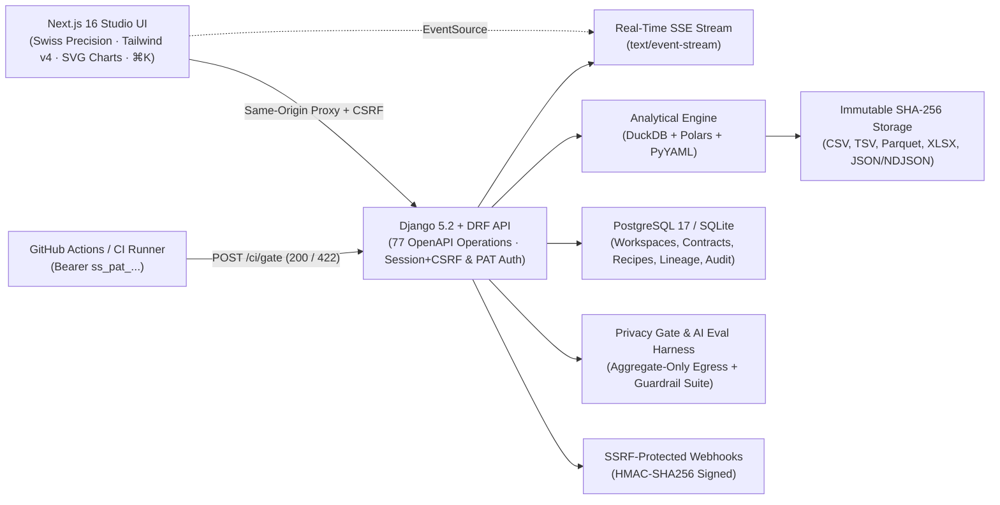

# SyntheSift

**Privacy-First Data Quality, ML Drift Observability, Declarative Data Contracts & Safe Transformation Studio.**

*Profile. Detect. Gate. Transform. Prove.*

[](contracts/openapi.yaml)
[](#architecture)
[](#studio-capabilities)
[](LICENSE)

---

## Why SyntheSift Exists

Most data-quality tools fall into one of two failure modes: heavyweight cloud platforms that leak raw customer rows into third-party AI APIs, or brittle notebook scripts with no reproducibility, lineage, or CI/CD enforcement.

**SyntheSift v2.0** is a full-stack modular monolith engineered around four non-negotiable guarantees:

1. **Zero Raw-Row Leakage:** Stored statistical profiles, ML drift comparisons, contract evaluation logs, audit events, and outbound LLM prompts never contain raw dataset cells or PII.
2. **Deterministic Safety Over LLM Code Execution:** AI analysis produces schema-validated, evidence-cited proposals (`F1`, `C2`, ...) that deterministically synthesize into a strictly allowlisted 15-operation Transformation DSL—never arbitrary generated Python or SQL.
3. **Immutable Content-Addressed Provenance:** Every uploaded file and derived output is SHA-256 verified on disk and linked inside an interactive project Lineage DAG (`v0 -> Recipe -> v1`).
4. **CI/CD Ready Governance:** Engineering pipelines can gate pull requests headlessly via SHA-256 hashed Personal Access Tokens (`ss_pat_...`), declarative YAML Data Contracts, and HMAC-SHA256 signed webhooks.

---

## Architecture



---

## Studio Capabilities

### 1. Multi-Format Analytical Engine & Interactive Data Grid
- **6 Tabular Formats:** Native ingestion and admission validation for `CSV`, `TSV`, `Parquet`, `Excel (.xlsx)`, `JSON`, and `NDJSON`.
- **Polars/DuckDB Profiler v2:** Quantiles (`p5`–`p95`), standard deviation, IQR outlier fences, skewness, 12-bin histograms, Pearson correlation matrix, whitespace/sentinel-null diagnostics, structural pattern shapes (`Aaaa`, `999-999-9999`), semantic type inference, and a transparent **5-Dimension Quality Index** (`Completeness`, `Uniqueness`, `Validity`, `Consistency`, `Privacy Safety`).
- **PII & Secret Scanner:** Automatically detects emails, phones, SSNs, Luhn-verified credit cards, IPs, and API keys. Masks cells by default in the DuckDB-backed Data Grid with RBAC-gated reveal (audited automatically as `pii.unmasked`).

### 2. 15-Op Safe Transformation DSL, Cell-Level Diff & Lineage DAG
- **Visual Pipeline Builder:** Compose ordered steps across 15 validated primitives (`trim_whitespace`, `normalize_case`, `normalize_sentinel_nulls`, `replace_values`, `regex_replace` with ReDoS nested-quantifier blocking, `fill_missing`, `cast_type`, `standardize_date`, `clip_numeric`, `drop_duplicate_rows`, `filter_rows`, `rename_column`, `drop_columns`, `split_column`, `mask_pii`).
- **Dry-Run Cell Diffs & Quality Delta:** Preview exact before/after row & cell modifications before approving materialization of an immutable derived version.
- **Reproducible Code & Multi-Format Export:** Export any pipeline plan as runnable **Polars**, **Pandas**, or **DuckDB SQL**, save reusable project **Recipes**, and download cleaned datasets in `CSV`, `Parquet`, or `Excel (.xlsx)`.
- **Interactive Lineage DAG:** Visualizes dataset derivation chains (`v0 -> v1 -> v2`) with quality score deltas and one-click version inspection.

### 3. ML Drift Detection, Declarative Data Contracts & AI Eval Workbench
- **Statistical ML Drift Inspector:** Compare baseline vs. candidate datasets for schema drift (added/removed/type-changed columns), Population Stability Index (**PSI**), exact two-sample **Kolmogorov-Smirnov** test statistic & p-value, overlaid dual-distribution SVG histograms, and privacy-safe SHA-256 hashed categorical **Jensen-Shannon Divergence (JSD)** & TVD.
- **10-Rule Declarative Data Contracts (`synthesift.contract/v1`):** Author expectations visually or in Git-ready YAML (`expect_column_to_exist`, `expect_column_not_null`, `expect_column_unique`, `expect_column_values_between`, `expect_column_values_in_set`, `expect_column_regex_match`, `expect_column_no_pii`, `expect_column_no_whitespace_padding`, `expect_table_row_count_between`, `expect_column_mean_between`), 1-click **Auto-generate from profile**, and persist pass/fail Contract Gate runs.
- **AI Eval Workbench & Copilot-to-Pipeline Bridge:** Tracks live citation grounding, strict JSON schema compliance, latency, and prompt-technique reliability across saved reports; includes an offline **6-Case Adversarial Guardrail Benchmark Suite** (hallucinated evidence rejection, code-exec blocking, prompt-injection overflow, ReDoS prevention, calibrated abstention) and a **Draft into Pipeline Builder** button that deterministically translates grounded AI citations into validated DSL steps.

### 4. Enterprise Governance, CI/CD Quality Gates & Real-Time SSE (`/governance`)
- **Workspace Personal Access Tokens (`ss_pat_...`):** SHA-256 hashed at rest, displayed once on creation, strictly workspace-scoped with granular scopes (`read`, `write`, `gate:run`), expiry, and instant revocation.
- **Headless CI/CD Quality Gate API (`POST .../ci/gate`):** Accepts multipart uploads or existing `dataset_id`, enforces quality score floor, zero-PII policy, Data Contracts, and ML Drift thresholds, returns **HTTP 200** (pass) or **HTTP 422** (fail) plus a ready-to-post **GitHub PR Comment Markdown** table.
- **SSRF-Protected HMAC-SHA256 Webhooks:** Blocks private/loopback/metadata IPs, signs deliveries with `X-SyntheSift-Signature: t=<ts>,v1=<hmac_sha256>`, and records delivery telemetry.
- **Immutable Workspace Audit Trail:** Filterable JSON-exportable log of PAT lifecycle, CI gates, contract runs, pipeline approvals, webhook operations, and PII unmask events.
- **Real-Time SSE Streaming (`/events`):** `text/event-stream` endpoint + `useDatasetEventStream` hook pushing live job status updates directly into the Dataset Studio.

---

## Security & Privacy Invariants

| Boundary | Enforcement Mechanism |
| :--- | :--- |
| Raw cell storage in profiles/drift/audit | Pattern shapes & SHA-256 token hashes only; verified by automated privacy regression tests |
| External AI egress | Explicit user consent checkbox; aggregate evidence only (zero raw rows sent) |
| LLM output safety | Strict JSON schema validation, evidence-ID grounding check, allowlisted actions, zero code execution |
| Regex safety (DSL & Contracts) | Nested quantifier detection rejects catastrophic ReDoS patterns before execution |
| PII visibility | Masked by default in Data Grid & Pipeline Diffs; unmask requires `owner`/`editor` role and writes `pii.unmasked` audit event |
| Webhook SSRF defense | Blocks `localhost`, RFC1918 private networks, link-local (`169.254.169.254`), and internal domains |
| Auth & CSRF | HttpOnly SameSite=Lax sessions + strict CSRF on browser mutations; SHA-256 hashed workspace-scoped PATs for headless CI |

---

## CI/CD Quality Gate Example (GitHub Actions)

```yaml
name: SyntheSift Data Quality Gate
on:
  pull_request:
    paths: ["data/**/*.csv", "data/**/*.parquet"]

jobs:
  data-quality-gate:
    runs-on: ubuntu-latest
    steps:
      - uses: actions/checkout@v4
      - name: Enforce Quality, Zero-PII & Data Contract Gate
        env:
          SYNTHESIFT_URL: ${{ secrets.SYNTHESIFT_URL }}
          SYNTHESIFT_TOKEN: ${{ secrets.SYNTHESIFT_TOKEN }}
        run: |
          curl --fail-with-body -sS -X POST \
            "${SYNTHESIFT_URL}/api/v1/workspaces/${{ vars.SYNTHESIFT_WORKSPACE_ID }}/projects/${{ vars.SYNTHESIFT_PROJECT_ID }}/ci/gate" \
            -H "Authorization: Bearer ${SYNTHESIFT_TOKEN}" \
            -F "file=@data/release_batch.parquet" \
            -F "min_quality_score=85" \
            -F "fail_on_pii=true"
```

---

## Quick Start

### Option A: Local Development (No Docker Required)

**1. Backend (Python 3.12+ / Django 5.2 / DuckDB / Polars)**

```bash
python -m venv .venv
# Linux/macOS: source .venv/bin/activate
# Windows PowerShell: .\.venv\Scripts\Activate.ps1

pip install -r apps/api/requirements.txt -r apps/api/requirements-dev.txt

export DATABASE_URL="sqlite:///$(pwd)/local_data/dev_v2.sqlite3"
export DATASET_STORAGE_ROOT="$(pwd)/local_data/datasets"
export CACHE_REDIS_URL="locmem://"
export CELERY_TASK_ALWAYS_EAGER="true"
export DJANGO_DEBUG="true"
export DJANGO_CSRF_TRUSTED_ORIGINS="http://localhost:3001,http://127.0.0.1:3001,http://localhost:3000,http://127.0.0.1:3000"

cd apps/api
python manage.py migrate
python manage.py runserver 127.0.0.1:8001 --noreload
```

**2. Frontend (Node.js 22+ / Next.js 16 / Tailwind v4)**

```bash
cd apps/web
npm install
API_INTERNAL_URL=http://127.0.0.1:8001 npx next dev -H 127.0.0.1 -p 3001
```

Open `http://localhost:3001`, register an account, create a workspace & project, and click **Load sample datasets** to immediately explore CSV, Parquet, and JSON datasets across the Studio Workbench (`/workbench`) and Governance Console (`/governance`). Interactive Swagger docs are available at `http://127.0.0.1:8001/api/docs/`.

### Option B: Docker Compose (Full Stack with PostgreSQL 17, Redis & Celery)

```bash
cp .env.example .env
docker compose up --build -d
docker compose exec -T api python manage.py verify_worker --timeout 12
```

---

## Repository Structure

```text
apps/
  api/
    ai_remediation/     Evidence-grounded Gemini review, AI Eval Workbench, Copilot-to-DSL bridge
    contracts_engine/   10-rule Data Contracts engine, YAML import/export, persisted gate runs
    core/               Health probes, request ID middleware, structured exception handling
    datasets/           Multi-format ingestion, DuckDB/Polars profiler v2, PII scanner, Rows API, SSE stream
    governance/         PAT auth, headless CI/CD Quality Gate, SSRF-safe HMAC webhooks, Audit Trail
    identity/           Session/CSRF auth, workspaces, RBAC membership policy
    pipelines/          15-op safe DSL, dry-run cell diffs, Polars/Pandas/SQL codegen, Lineage DAG, ML Drift
    projects/           Workspace-isolated project containers
    tests/              Pytest integration, security, privacy, drift, contract, governance & SSE suites
  web/
    app/
      components/
        governance/     CI/CD Gate Simulator, PAT manager, HMAC Webhooks & Audit Trail console
        landing/        Interactive landing showcase
        shell/          AppShell navigation rail & ⌘K Command Palette
        studio/         Dataset Studio, DuckDB Grid, Column Drawer, Pipeline Builder, Drift, Contracts, Lineage, AI Evals
        ui/             Handcrafted Swiss SVG charts (Score Meter, 5D Bars, Histograms, Box Plots, Heatmap)
    lib/                Typed API client, SSE event stream hook, formatters
    tests/              Vitest + React Testing Library component & workflow suites
contracts/
  openapi.yaml          Reviewed OpenAPI 3.0 contract (77 operations verified against Django schema)
scripts/                OpenAPI drift check, repo secret audit, release & smoke checks
```

---

## Verification & Quality Gates

```bash
# Backend: Lint, Django checks, OpenAPI contract parity (0 errors), full pytest suite, secret audit
ruff check apps/api
python scripts/check_repo_secrets.py
cd apps/api
DATABASE_URL="sqlite:///:memory:" CACHE_REDIS_URL="locmem://" CELERY_TASK_ALWAYS_EAGER="true" python manage.py check
DATABASE_URL="sqlite:///:memory:" CACHE_REDIS_URL="locmem://" CELERY_TASK_ALWAYS_EAGER="true" python manage.py spectacular --file ../../contracts/openapi.generated.yaml --validate
python ../../scripts/check_contract.py ../../contracts/openapi.yaml ../../contracts/openapi.generated.yaml
DATABASE_URL="sqlite:///:memory:" CACHE_REDIS_URL="locmem://" CELERY_TASK_ALWAYS_EAGER="true" pytest -q

# Frontend: ESLint, TypeScript strict check, full Vitest suite
cd apps/web
npm run lint
npm run typecheck
npm test
```

Security reporting and architectural decision records live in [SECURITY.md](SECURITY.md), [CONTRIBUTING.md](CONTRIBUTING.md), and `docs/`.
