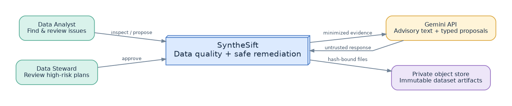
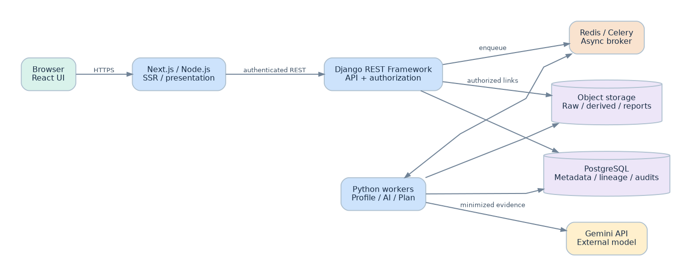
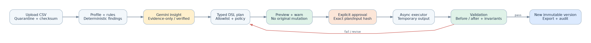
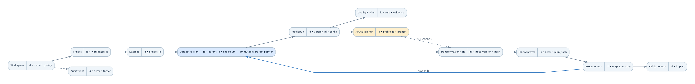

# 02 — Complete Software Architecture Plan

> **SyntheSift v1.0 | Architecture baseline | C4-inspired, domain-driven modular monolith**

## 1. Architectural drivers and constraints

**Architectural priorities, in order:** correctness of findings and transformations; original-data preservation; strong privacy/security boundary; understandable evidence and human approval; reproducibility and operability; extensibility; reasonable performance and cost. The application is intended to be genuinely deployable, but does not pretend to have enterprise controls before they are built and independently verified.

**Hard technology constraints:** Next.js/React (Node.js runtime), Django REST Framework (Python), PostgreSQL, Matplotlib/Seaborn, Gemini API. Supporting components Redis/Celery and object storage are authorized by this design. Avoid duplicated business logic across JavaScript and Python; reusable contracts are generated or validated from schema.

**Quality attribute scenarios:**

| Attribute | Stimulus / environment | Required response |
|---|---|---|
| Integrity | Model suggests delete/drop | Executor rejects unless allowlisted and separately approved; source remains unchanged |
| Privacy | File contains email and name fields | PII classifier redacts from evidence; default Gemini payload contains aggregates only |
| Availability | Gemini times out | Analysis remains usable; recommendations show retryable state without rerunning profiling |
| Isolation | User queries another project ID | API denies; no metadata, chart, export or object leaks |
| Reliability | Worker crashes after upload | Run enters recoverable or terminal state; retry is idempotent; no partial visible version |
| Explainability | Recommendation cites non-existing issue | Reject with validation reason; do not present as verified recommendation |
| Auditability | User applies plan | Persist approval, plan hash, input/output hashes, executable version, test outcomes |
| Cost | User resubmits identical AI request | Idempotent or cache hit when policy allows; budget enforced before model call |

## 2. Architecture viewpoints (C4-inspired)

### L1: System context

Actors: Analyst (operate), Data Steward (review), Admin/Owner (configure), Hiring/Code Reviewer (inspect only demo), and external Gemini API (inference). User-provided CSV is untrusted inbound data. Report downloads are trusted artifacts only after export escaping and access authorization. See `diagrams/01_context.png` and editable `.mmd`.



### L2: Container topology

- **Browser:** authenticated interactive UI, dataset issue explorer, safe preview and approvals.
- **Next.js server / Node runtime:** serves SSR/SPA UI and acts as presentation/BFF where useful; does not access Gemini credentials or dataset binaries directly.
- **Django REST API:** single authority for identity, tenant/project access, metadata, workflow state transitions, and export link issuance; calls application services.
- **Celery workers:** parse/profile/analyze, invoke Gemini, preview/apply plans, validate and generate charts/reports; queues are separated by job class and resource needs when scaling.
- **PostgreSQL:** normalized records, immutable revision identifiers, profiling summaries, issues, plans, AI call metadata and audit events; not used to store original large file blobs.
- **Redis:** Celery broker / ephemeral cache and rate counters; never source of truth for persisted job state.
- **Object store adapter:** stores raw immutable source files, derived versions, report exports, rendered PNG/SVG charts; version IDs and hashes in PostgreSQL.
- **Gemini API:** external untrusted generative dependency, reachable **only** through backend Gemini adapter with egress controls and observability.



**Deployment boundary:** Browser ↔ HTTPS ingress ↔ Next.js and DRF. DRF ↔ PostgreSQL/Redis/object store. Only workers ↔ Gemini. Network denies cross-tenant object access and public DB/Redis access. TLS on all external hops; appropriate private/encrypted internal transport for hosted deployment.

### L3: Backend modules, ports and adapters

```text
apps/
  identity/          # users, projects, membership, permission policy
  datasets/          # file admission, schema, versioning and artifact pointers
  profiling/         # deterministic metrics, stratification, type inference
  quality/           # rule registry, findings, scoring and severity
  anomalies/         # statistical anomaly advisors + rationale
  ai/                # evidence builder, prompt registry, Gemini adapter, eval
  remediation/       # DSL parser, plan policy, preview and executor
  validation/        # impact checks, before/after, invariants
  reporting/         # exports and Matplotlib/Seaborn chart rendering
  jobs/              # Celery orchestration, status persistence, idempotency
  audit/             # event ledger and trace correlation
common/
  contracts/         # versioned serializers, enum definitions, error contracts
  storage/           # object store interface and local/S3 adapters
  security/          # sanitizers, privacy policy, quotas
```

Each app has API (views/serializers), application (use cases), domain (entities/policies), infrastructure (ORM/adapters), and tests. Domain code must not import Django views or model SDKs. App-to-app interactions pass through application services and typed events, not raw foreign ORM mutation.

**Frontend package modules:** route groups `(auth)`, `(dashboard)`, datasets/[id], analysis/[id], remediation/[id], runs/[id]; features/* components and hooks; lib/api (OpenAPI-derived typed client); lib/contracts; lib/errors; components/ui; charts as secure backend assets plus accessible data tables. React Query/TanStack Query may be adopted via ADR; forms use schema-derived validation when appropriate.

### L4: Critical execution detail

**Trusted rule engine:** consumes parsed bounded data; emits deterministic `ProfileRun`/`QualityFinding` and artifact references. **EvidenceBuilder:** selects aggregate facts, removes PII or secrets, computes content hash and provenance. **PromptCompiler:** versioned instruction/few-shot templates generate an expected Pydantic schema. **ModelGateway:** isolates SDK, retries, provider quotas, timeouts and per-request cost. **ResponseVerifier:** schema validation, evidence-ID resolution, operation allowlist, risk policy, contradiction checks. **RemediationEngine:** standardized typed plan → preview on bounded data → full apply after explicit approval → validation → new immutable version.

## 3. Canonical workflows and sequences

### A. Upload and deterministic analysis

1. UI requests an upload session with size/name/type; backend returns a project-scoped upload ID and quota policy.
2. Upload is streamed into quarantine; enforce size while reading, content sniffing, extension allowlist, parser schema limits, UTF-8/encoding policy and scan policy. Do not trust `Content-Type`.
3. Compute SHA-256, content length and source metadata; perform atomic object commit; persist `DatasetVersion v0` with SHA and immutable URI.
4. Enqueue profiling **after database commit** to avoid worker/transaction races.
5. Worker reads object via streaming or bounded chunking, reports progress, computes metrics/findings, writes results atomically, and emits a completed `ProfileRun`.
6. UI polls run state or subscribes via future SSE; results render as issue cards, charts and accessible tables.

### B. Evidence-grounded AI recommendations

1. User explicitly requests recommendations from selected completed profile.
2. Authorization, privacy policy, budget and per-tenant quota checks.
3. EvidenceBuilder generates a canonical, size-bounded JSON fact pack with stable finding IDs and redaction summary.
4. Prompt uses (i) role/task constraints, (ii) few-shot examples, and (iii) schema-based structured output; optional second-pass critique after offline cost-benefit tests.
5. Gemini response parsed into versioned Pydantic DTO, then checked for evidence support, plan validity, contradictions and policy.
6. Accepted recommendations persisted with provenance; rejected ones marked invalid with reasons. Both outcomes log no sensitive row values.
7. User reads explanation, confidence wording, and limits; no implicit execution follows recommendation.

### C. Plan preview, approval, apply and validation



1. `PlanDraft` created from user-selected safe operations, with current source-version hash and schema version.
2. `PlanValidator` checks syntax/semantics, column existence and types, bounded maps, overflow, no illegal mutation and business rule compatibility.
3. `PreviewRun` applies plan to a deterministic bounded sample, recording rows affected and changes. **Preview is indicative, not a promise of full-result cardinality.**
4. High-impact operations show separate impact warnings; user explicitly approves exact plan hash and input version.
5. Worker rechecks authorization, approved hash, source hash, freshness/preconditions, quotas and constraints at execution time.
6. Apply writes to a temporary object; validation reruns relevant rules and row/column invariants; on success atomically commits new version and metadata. On failure, mark run failed, retain original and discard or quarantine temporary output. Never mutate v0 in place.
7. Report contains side-by-side metrics with methodology and warning where any metric worsened; failures or trade-offs do not silently count as success.

## 4. Data architecture and domain model



| Aggregate / table | Key properties | Invariants |
|---|---|---|
| `Workspace` | id, owner_id, created_at, policy_version | Scope for every private resource |
| `Membership` | workspace_id, user_id, role | No cross-workspace implicit access |
| `Project` | id, workspace_id, name | Parent of all datasets |
| `Dataset` | id, project_id, display_name | Logical dataset identity |
| `DatasetVersion` | id, dataset_id, parent_version_id, file_sha256, storage_key, format, row_count, schema_hash, created_at | Immutable raw/derived bytes; DAG lineage |
| `UploadSession` | id, dataset_id, status, upload_size, checksum | Explicit admission state machine |
| `ProfileRun` | id, version_id, engine_version, config_hash, status, metrics_ref | Run tied to exact content and config |
| `QualityFinding` | id, profile_run_id, rule_code, version, severity, evidence_json, affected_count | Evidence source stable and retrievable |
| `AIAnalysisRun` | id, profile_run_id, evidence_hash, prompt_version, model_name, params, tokens, status | Attribution and budget audit |
| `Recommendation` | id, ai_run_id, evidence_refs, risk, plan_json, validation_state | Reject orphaned/unsafe steps |
| `TransformationPlan` | id, input_version_id, schema_version, ordered_steps_json, hash, status | Approval bound to exact immutable hash |
| `PlanApproval` | id, plan_id, approver_id, timestamp, plan_hash, policy_ack | Cannot approve changed plan silently |
| `ExecutionRun` | id, plan_id, input_version_id, output_version_id, status, impact_json | Idempotent; output only on validation success |
| `ValidationRun` | id, execution_run_id, before_ref, after_ref, invariant_results | No success without evidence |
| `ReportArtifact` | id, version_id, report_ref, format, retention_expiry | Authorized, tracked, safe export |
| `Job` | id, kind, entity_ref, status, attempt, idempotency_key | Persistent, observable queue state |
| `AuditEvent` | id, workspace_id, actor_id, action, target, timestamp, trace_id, metadata | Append-only application policy and restricted access |

**Database constraints:** indexed `(workspace_id, created_at)` on tenant-scoped reads; `(dataset_id, created_at)` on versions; unique `(workspace_id, idempotency_key, operation)`; FK integrity; enum/check constraints for statuses; JSONB for validated report details only; transaction boundaries for state transitions. Do not store raw untrusted CSV rows or provider API keys in metadata columns. For production tenancy consider PostgreSQL row-level security as **additional** defense, not replacement for object-level DRF permission checks.

**Artifact storage:** content-addressed or version-ID keyed objects with separately scoped tenant prefix and server-checked authorization; private bucket; at-rest encryption; integrity hash; lifecycle expiration and delete workflows. Signed URLs are short-lived and scoped to a single artifact. Raw source, derived versions, generated images and exports have distinct retention classes.

## 5. Explicit state machines

| Entity | States | Valid transitions |
|---|---|---|
| Upload | `CREATED`, `QUARANTINED`, `VALIDATED`, `REJECTED`, `COMMITTED` | created→quarantined→validated→committed; reject from eligible states |
| Job | `QUEUED`, `RUNNING`, `SUCCEEDED`, `FAILED`, `CANCELLED` | queued→running→terminal; transient failures can retry under same persisted logical job |
| AI analysis | `REQUESTED`, `RUNNING`, `ACCEPTED`, `PARTIAL`, `REJECTED`, `FAILED` | requested→running→terminal validated result |
| Plan | `DRAFT`, `VALIDATED`, `PREVIEWED`, `APPROVED`, `APPLIED`, `REJECTED`, `STALE` | draft→validated→previewed→approved→applied; any source/hash change→stale |
| Version | `CREATING`, `AVAILABLE`, `FAILED`, `DELETED_BY_POLICY` | creating→available/failed; deletion follows retention/admin policy |

Transitions occur in application transactions under lock/version checks. An asynchronous task must not infer success from a message acknowledgment alone.

## 6. API architecture and contract

Canonical prefix: `/api/v1/`. **OpenAPI** is normative for concrete request/response DTOs once endpoints are implemented. The included `contracts/openapi.yaml` is an initial design skeleton; endpoints below describe planned contracts and should become exact OpenAPI definitions before feature release.

| Method | Endpoint | Purpose / status |
|---|---|---|
| `POST` | `/auth/login` | Session establishment, CSRF |
| `GET/POST` | `/projects` | list/create authorized projects |
| `POST` | `/projects/{id}/datasets/uploads` | upload session / multipart admission |
| `GET` | `/datasets/{id}` | metadata and versions |
| `GET` | `/dataset-versions/{id}/profile` | latest or specified profile run |
| `POST` | `/dataset-versions/{id}/profiles` | queued deterministic profile |
| `GET` | `/profiles/{id}/issues` | paged/filterable findings |
| `POST` | `/profiles/{id}/ai-analyses` | queued Gemini recommendation run |
| `GET` | `/ai-analyses/{id}` | state, validated recommendations, provenance |
| `POST` | `/plans` | draft typed transformation plan |
| `POST` | `/plans/{id}/validate` | validate DSL and policy |
| `POST` | `/plans/{id}/previews` | simulate bounded preview |
| `POST` | `/plans/{id}/approve` | bind approval to exact hash/version |
| `POST` | `/plans/{id}/executions` | idempotent approved apply |
| `GET` | `/jobs/{id}` | durable status/progress/error |
| `GET` | `/dataset-versions/{id}/lineage` | parent/child and execution evidence |
| `POST` | `/dataset-versions/{id}/reports` | queue export generation |
| `GET` | `/artifacts/{id}/download` | authorized short-lived artifact delivery |

**API design decisions:** 202 Accepted for async work with `job_id` and `Location`; `Idempotency-Key` for mutation; `X-Request-ID` propagation; 409 for stale plan/version conflicts; 422 for invalid data/DSL; 403 for forbidden; 429 for quotas; 503 for provider/outage with retry hint; stable `error.code`, `message`, `details`, `request_id`. Pagination by cursor for findings; filtering/sorting never bypass tenant authorization. Upload/status actions specify size/timeout policies. API contract tests prevent accidental breaking changes.

## 7. Data profiling, anomaly policy and quality scoring

Analysis is reproducible and independent of Gemini. Use exact metrics on bounded MVP datasets; large-dataset streaming/sampling should be an explicit future design with clear approximation labels. Rule engine uses a registry with names, versions, typed configs, severity mapping and fixtures. Common checks include missingness, duplicate records, unique key violation, invalid number/date parsing, suspicious numeric ranges, inconsistent categorical labels, regex/format violations, schema mismatch and IQR-based outliers.

**Anomaly vs defect:** IQR flag is an advisory observation, not automatic deletion. If anomaly models (IsolationForest etc.) are added, log model version, features, fit policy, seed, contamination assumptions and validation set. Expose false-positive concerns in the UI. A dataset quality score must not obscure high-severity rule violations or imply ML predictive certainty.

## 8. Performance, scalability and capacity

**Proposed pilot targets — not validated service guarantees:**

- Upload admission acknowledgment under 3 s p95 for a small upload after transfer completes; full parsing is async.
- 25 MiB / 250k-row reference CSV profile within 120 s p95 on a documented test worker class (baseline to be measured).
- Dashboard cached profile response < 2 s p95 under a stated reference load.
- Under normal provider availability, Gemini request within 60 s endpoint timeout, subject to queueing and provider rate limits; late jobs remain visible.
- Hosted pilot availability aspiration 99.5% monthly excluding disclosed maintenance; define SLI/SLO only after actual monitoring exists.

**Scaling path:** start docker-compose 1 API, 1 worker, Redis, PostgreSQL and object store; profile worker memory budgets; scale workers horizontally on distinct Celery queues; keep API stateless; partition artifact storage; instrument top slow rules; consider columnar/Arrow/DuckDB execution as an ADR **only when benchmarks warrant**. Avoid treating Pandas as unbounded or assuming in-memory CSV safety.

## 9. Reliability, failure modes and recovery

| Failure | Required mitigation | User-facing behavior |
|---|---|---|
| CSV malformed / encoding unknown | Reject/quarantine with parser location where safe | Actionable upload error; no half-import |
| Oversize / memory pressure | Streaming guards, limits, worker memory cap | Quota failure; original upload state retained appropriately |
| Worker killed | Lease/heartbeat and durable job state reconciliation | Visible retry path without duplicate output |
| Gemini quota / timeout | Exponential backoff + jitter, bounded attempts and circuit breaker | Profile usable; AI run marked retryable |
| Gemini invalid output | Pydantic + policy verification; at most bounded repair attempt | Reject unsupported proposals; never execute |
| Object store failure | Atomic temp object + promote; cleanup orphan temp objects | No phantom successful dataset version |
| Stale approval | Re-check plan hash, source checksum, policy version | Conflict + re-preview/re-approve |
| DB or Redis outage | Health checks, persistence of job records and recoverable state | Clear outage and retry/error surface |
| Compromised CSV payload | Strict parsing, CSV export escaping, no evaluation | No arbitrary code / formula execution |

Use transactional **outbox pattern when reliable cross-system events become necessary**; initial Celery enqueuing after DB commit plus reconciliation is sufficient for MVP if its failure window is measured. Design all worker tasks to be idempotent and safe under at-least-once delivery.

## 10. Security architecture at boundaries

Authentication: favor server-managed session cookies `HttpOnly`, `Secure`, `SameSite` and CSRF enforcement under a controlled same-origin reverse proxy; explicit RBAC roles `OWNER`, `EDITOR`, `VIEWER` with minimum privileges. DRF auth != permission: enforce resource/tenant object permission on every lookup and artifact download. Never store bearer tokens in localStorage. Gemini API key available only to workers/server environment, not Next.js public variables.

Threat boundaries: internet→ingress; web→DRF; DRF→database/objects; worker→untrusted dataset; worker→Gemini; model output→DSL validator; generated CSV/report→user. Maintain egress restrictions, least privilege, dependency integrity, secrets rotation, encryption, privacy minimization, upload quarantine and export sanitization. See dedicated security doc and threat diagram.

## 11. Deployment and environment topology

**Development:** `docker compose up --build` for frontend, API, Celery worker, Redis, PostgreSQL, and local object storage (either mounted volume adapter or MinIO). Include migrations and seed fixtures, health endpoints, deterministic sample dataset, `.env.example`, and local request tracing.

**CI:** isolated Postgres/Redis, no required paid model calls for routine tests; fake Gemini provider for deterministic behavior; optional manual live-provider smoke gated by secrets. Build/test OCI images and publish artifacts only on release tag after security and license scans.

**Staging:** isolated storage/DB/secrets, synthetic datasets, real Gemini test with egress policy, TLS and request quotas; rehearse migration and restore.

**Production candidate:** managed PostgreSQL, Redis, object storage and container runtime; automated encrypted backups and restore tests; TLS, DNS, observability, worker resources, rate limiting at edge, logging retention, secrets manager, incident runbooks and cost alerts. Do not label this deployment production-ready until the launch checklist passes.

**Configuration:** `DATABASE_URL`, `REDIS_URL`, `STORAGE_BACKEND`, `GEMINI_API_KEY`, `GEMINI_MODEL`, `GEMINI_TEMPERATURE`, `GEMINI_TOP_P`, `GEMINI_MAX_OUTPUT_TOKENS`, `UPLOAD_MAX_MIB`, `DATASET_ROW_LIMIT`, `AI_DAILY_BUDGET`, `LOG_LEVEL`, environment-scoped `SECRET_KEY`, CORS/CSRF allowlist. Avoid hardcoding provider model IDs in architecture; pin evaluated IDs in versioned configuration at implementation.

## 12. Observability and operations

Structured logs: `timestamp`, `level`, `service`, `trace_id`, `request_id`, `workspace_id_hash`, `job_id`, `dataset_version_id`, `event`, `duration_ms`, `error_code`, without raw row values, payloads or secrets. Metrics: job queue depth, worker time, API 4xx/5xx, profile latency, failed uploads, AI schema reject rate, token/cost per project, transform rollback count, failed validation count. Traces link user request→worker job→provider call→stored results; redact payload attributes.

Health endpoints: `/health/live` (process), `/health/ready` (dependency-aware), optional `/metrics` restricted to operators. Runbooks: Gemini outage, corrupt upload, stuck jobs, restore from backup, accidental export, potential privacy leak and excessive billing. Set data retention (raw, derived, audit, report, provider metadata) before hosted public signup.

## 13. Architecture fitness functions and exit criteria

Architecture checklists are executable where feasible: no `google.genai` imports outside adapter; no arbitrary `eval`, `exec`, `subprocess` in transformation executor; no direct mutable writes to source version; all user-scoped queries require workspace checks; 100% API endpoints documented; all state transitions tested; no ML call in web view handler; token/cost telemetry exists; security scans clean of critical findings; no sensitive data in logs. Build module import boundary checks and synthetic cross-tenant API tests.

## 14. Architecture decisions and evolution

The repository includes ADRs for (1) modular monolith, (2) deterministic authority + advisory Gemini, (3) safe typed DSL with human approval, (4) object storage and immutable lineage, and (5) async job execution. Future changes to auth, privacy, model provider, storage format, score formula or tenancy require a new ADR, not undocumented drift.
