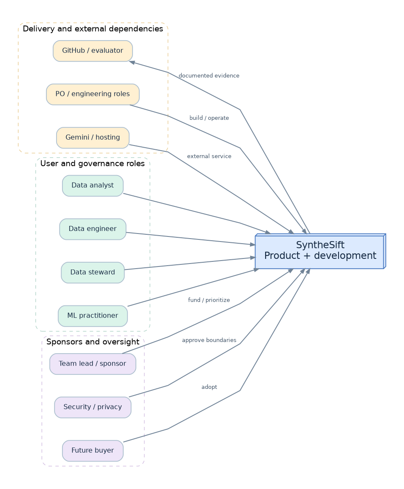
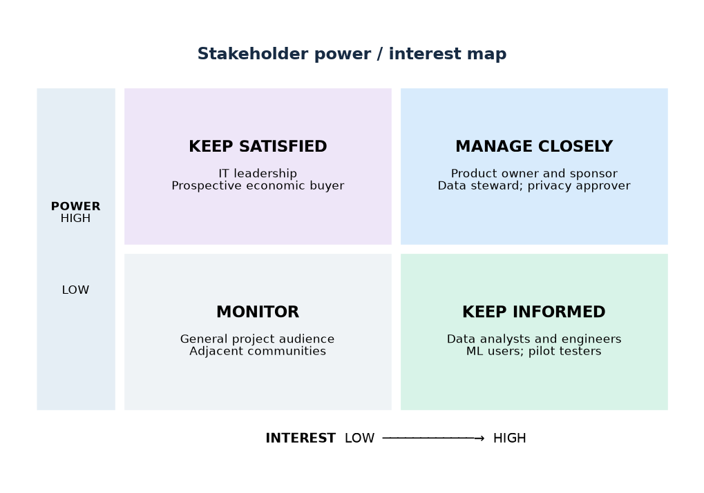

# 03 — Stakeholder Maps, Governance and Communication Plan

> SyntheSift v1.0 | 2026-10-23 | Planning artefact; stakeholder assignments are proposed, not confirmed appointments.

## 1. Scope and stakeholder definitions

This document distinguishes **users** (who perform a workflow), **buyers/sponsors** (who fund or select a solution), **governance stakeholders** (who can constrain processing), and **delivery/operations stakeholders** (who must build and maintain it). For a solo portfolio project, the developer temporarily occupies several delivery roles; these are separate *accountabilities*, not fictitious employees. Stakeholder engagement frequencies below become operational after external pilot users exist.

## 2. Stakeholder ecosystem map

| Group | Stakeholder | Primary goal | Needs from product | Failure concern | Representative evidence |
|---|---|---|---|---|---|
| Primary user | Data analyst | Trust datasets for reporting | Understandable findings, remediation preview, clear export | Misleading quality score or silent data loss | Task completion and qualitative usability interview |
| Primary user | Data engineer | Repeatable quality workflows | APIs, rules, lineage, reproducibility | Nondeterministic operations, poor performance | Contract/integration and reproducibility tests |
| Governance user | Data steward / quality lead | Define and approve standards | Explainability, rules, approvals, audit evidence | Unreviewed high-impact modifications | Approval logs and policy coverage |
| Adjacent user | ML engineer / scientist | Detect training-data problems | Profiling, anomalies with uncertainty, version comparison | Misclassification of unusual values as errors | Labeled fixture and false-positive evaluation |
| Business sponsor | Team lead / analytics manager | Reduce manual cleanup cost | Adoption, actionable reports, acceptable operating cost | Cost growth, low trust, maintenance burden | Pilot utility metrics and cost per completed workflow |
| Economic buyer (future) | SME IT manager / product owner | Select affordable tooling | Pricing clarity, support, reliability, integration | Vendor lock-in, poor security | Pilot feedback and documented service targets |
| Decision gate | Security/privacy reviewer | Protect sensitive uploads | Data-flow maps, retention, redaction, access controls | PII transmission to model or tenant data leakage | Threat model, negative tests, privacy impact review |
| Delivery | Product owner | Focus roadmap and usability | Scope, priorities, acceptance criteria | Building technically impressive but unused features | Backlog and validation interviews |
| Delivery | Frontend engineer / UX | Safe and usable interaction | Design system, error states, accessibility | Confusing previews and irreversible actions | Playwright, accessibility review |
| Delivery | Backend/data engineer | Reliable processing | Domain contracts, queue architecture, storage policy | Invalid parsing, worker crashes, state corruption | Unit/integration and failure-injection tests |
| Delivery | AI/evaluation engineer | Useful grounded recommendations | Eval set, prompt registry, cost/latency telemetry | Hallucinations and fragile prompt behavior | Ablations, provenance and schema pass rate |
| Delivery | DevOps/SRE | Operable service | Alerts, resource bounds, backups and runbooks | Outage, runaway bills, unbounded resource use | Deployment rehearsals, restore and load tests |
| External dependency | Gemini API provider | Serve authorized inference | Compatible SDK/API use and quotas | API changes, downtime, privacy policy mismatch | Adapter tests and degraded-mode demo |
| External dependency | Hosting/storage provider | Durable infrastructure | Correct configurations and lifecycle settings | Data exposure or unavailable artifacts | IaC reviews and recovery drills |
| Evaluation | Recruiter / software reviewer | Assess engineering capability | Reproducible demo, tests, concise architecture | Unverifiable claims, fake screenshots | README, CI, demo video and ADRs |
| Downstream | Report consumer / auditor | Review remediation evidence | Linked dataset version, rule definitions, metrics, provenance | Report lacks method or omits harms | Report snapshots and audit trace |
| Risk owner | Data subject (where personal data present) | Preserve privacy and rights | Minimization, transparent handling and deletion path | Unwanted external disclosure or prolonged retention | Data handling policy and request workflow |

## 3. Stakeholder prioritization: power / interest

- **Manage closely (high power, high interest):** Product owner; pilot sponsor/team lead; data steward; security/privacy decision maker at hosted-launch gate.
- **Keep satisfied (high power, lower day-to-day interest):** Organizational IT/security leadership, hosting/contract approvers, prospective economic buyer.
- **Keep informed (lower decision power, high interest):** Data analysts, data engineers, ML practitioners, UX testers, downstream report consumers, delivery contributors.
- **Monitor (lower direct power, lower direct interest):** General GitHub viewers, adjacent ecosystem communities; reassess if they become active users/contributors.

**Dynamic rule:** Power/interest is contextual, not a permanent label. In the portfolio phase the project owner approves scope; in a customer pilot, a tenant's privacy/security approver may hold a hard go/no-go gate. The data subject is not reduced to an 'interest score' for rights handling: privacy obligations apply regardless of map quadrant.

## 4. Influence, dependency and trust map

| Relationship | Direction / leverage | Product consequence |
|---|---|---|
| Analyst → Data steward | Findings need business-context review | Support issue disposition and approval rationale |
| Data steward → Remediation execution | Policy and risk acceptance | Enforce explicit approval for destructive/high-impact changes |
| Security reviewer → Hosted pilot | Blocking assessment | Deny launch until upload, tenant isolation and model-egress controls pass |
| Gemini provider → AI workflow | Availability, quotas and model behavior | Provider adapter, offline fallback and request budget |
| Hosting/object store → Availability | Infrastructure durability | Backups, lifecycle rules and checksums |
| Engineering → End users | UX and processing correctness | Acceptance tests tied to realistic journeys |
| User feedback → Product roadmap | Demand and evidence | Feature priority based on observed problems, not demo novelty |
| Legal/privacy → Data policy | Handling constraints | Redaction, retention and deletion procedures require review |

## 5. RACI matrix: decision rights

**Legend:** R = Responsible for work; A = Accountable for approval (exactly one per activity); C = Consulted; I = Informed. `PO` product owner; `BE` backend/data; `FE` frontend/UX; `AI` AI/evaluation; `SEC` security/privacy; `OPS` DevOps/operations; `ST` data steward/customer representative. In a solo project, PO may execute the other roles while preserving separate checklists and evidence.

| Decision / deliverable | PO | BE | FE | AI | SEC | OPS | ST |
|---|:---:|:---:|:---:|:---:|:---:|:---:|:---:|
| Product scope, priority and MVP acceptance | A | C | C | C | C | I | C |
| Data model, version lineage and storage design | A | R | I | C | C | C | C |
| Upload bounds, parser security and data policy | C | R | I | C | A | C | C |
| Dataset rule correctness and evaluation fixtures | A | R | I | C | C | I | C |
| AI evidence, prompt design and model selection | A | C | I | R | C | I | C |
| Transformation allowlist and approval UX | A | R | R | C | C | I | C |
| High-impact plan approval in product | I | I | I | I | C | I | A/R |
| Authz, privacy threat model and model egress | C | R | C | C | A | C | C |
| Infrastructure, backups and incident response | C | C | I | I | C | A/R | I |
| API contract and compatibility gate | A | R | R | C | C | I | I |
| Release go/no-go: functionality and quality | A | R | R | R | C | C | C |
| Hosted public launch security gate | C | R | C | C | A | R | I |
| Incident triage and user communications | A | R | R | C | C | R | I |

**Solo implementation rule:** a solo author may fill `A` and `R`, but cannot honestly claim independent security audit. Record self-assessments and defer external attestation claims.

## 6. Stakeholder journey and value exchange

| Journey stage | Analyst | Steward / approver | Engineering/ops | What product must prove |
|---|---|---|---|---|
| Discover | Identifies inconsistent CSV | Defines acceptable data use | Checks file format / limits | Import is safe and understandable |
| Diagnose | Reviews metrics and finding IDs | Challenges severity where domain context matters | Tracks reproducible rules and logs | Evidence is deterministic and traceable |
| Recommend | Inspects AI suggestions | Reviews business consequences | Ensures privacy-safe fact package | Gemini output cites real evidence |
| Preview | Sees before/after sample and caveats | Assesses irreversible or lossy changes | Validates DSL constraints | Impact is visible; no silent execution |
| Approve/apply | Requests controlled remediation | Explicitly approves high-impact steps | Runs versioned job | Input locked to exact plan and hash |
| Verify/export | Compares metrics, downloads output | Signs off on exceptions | Confirms report provenance | Result may improve *or worsen* and both are reported |

## 7. Engagement and communications plan

| Audience | Cadence / event | Format | Owner | Trigger to escalate |
|---|---|---|---|---|
| Project owner / development | At each feature PR | Requirement linkage, test evidence, ADR | PO | Scope drift or acceptance failure |
| Pilot analyst / engineer | Once per prototype milestone | Observed usability session + survey | PO/FE | More than one critical task failure |
| Data steward | Before enabling lossy operation | Policy review and preview walkthrough | PO/BE | Ambiguous business impact or disputed finding |
| Security/privacy reviewer | Before external data pilot / release | Threat model, data inventory, test log | SEC | PII egress, broken isolation, missing deletion path |
| AI evaluator | On model/prompt/DSL change | Offline eval diff, cost/latency and failures | AI | Grounding regression or unsafe proposal |
| Operators | Prior to rollout and after incident | Dashboard/runbook and post-incident review | OPS | SLO breach, data integrity alarm or excessive spend |
| GitHub reviewers | Each tagged demo release | Release notes, reproducible commands, demo recording | PO | Build fails or claims unsupported |

## 8. Product decision framework / conflicts

Decisions prioritize **privacy and data integrity > correct interpretation > user control > availability > convenience > aesthetics**. Domain disagreements are resolved by exposing evidence and allowing documented finding disposition, **not** changing deterministic metrics to match model prose. Conflicts over data removal require a new plan, preview and separate approval. Product requests to transmit raw rows to Gemini require a policy change and a new ADR, rather than a silent feature flag.

### Sign-off gates

- **Architecture sign-off:** PO records an ADR and all affected API/data contracts; required for MVP implementation.
- **MVP functional sign-off:** demonstrable end-to-end workflow, passing negative scenarios, lineage and reports.
- **External pilot sign-off:** privacy/security controls, data policy, operation runbooks and deletion workflow verified.
- **Hosted public launch:** external review where warranted, capacity test, monitoring, backup restore, incident process and legal documentation.

## 9. Stakeholder hypotheses and research backlog

Do **not** present fictional interviews as completed research. Validate: (H1) analysts prefer issue-oriented navigation over a global score; (H2) stewards want rule-level policy control; (H3) data engineers prefer JSON plans or API over click-only workflows; (H4) evidence-cited AI reduces time to select a safe transformation; (H5) preview significantly reduces mistaken approval. Suggested discovery: 3–5 task-based interviews per persona group as an initial qualitative sample, followed by measured task studies; this is a planning target, not statistical representativeness.

## 10. Traceability and ownership

| Concern | Primary doc | Decision / check |
|---|---|---|
| User and buyer needs | `01_PRODUCT_HARNESS.md` | FR-001…FR-019 |
| Stakeholder roles | This file | RACI and sign-off gates |
| Trust and storage | `02_ARCHITECTURE.md` | ADR-0002, ADR-0004 |
| Threats/privacy | `04_SECURITY_PRIVACY.md` | Required security gate |
| Prompt/recommendation evaluation | `05_QUALITY_AI_EVAL.md` | Evidence quality and safety metrics |
| Sequencing and dependencies | `06_DELIVERY_PLAN.md` | Increment exit criteria |
