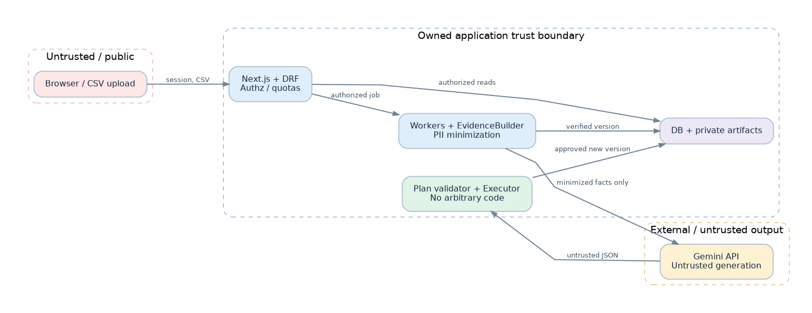

# 04 — Security, Privacy and Trust-Boundary Specification

> v1.0 | Proposed controls; production compliance is not asserted.

## 1. Assets, adversaries and trust boundaries

**Crown jewels:** uploaded dataset bytes (possibly sensitive), extracted evidence summaries, user identity, membership and permissions, immutable lineage, approvals, exported datasets/reports, Gemini credentials, audit trail and encryption keys. Threat actors include unauthenticated visitors, malicious authenticated users, compromised dependencies, misconfigured operators and attackers embedding instructions in uploaded data.

| Boundary | Untrusted input | Must enforce | Must never assume |
|---|---|---|---|
| Browser → Next.js/DRF | Tokens, IDs, user-entered names, uploads | Session/CSRF, authz, rate limits, validation | Client-side roles or filenames prove authorization |
| Upload → quarantine/parser | CSV bytes and formulas | Streaming size/row/column checks, encoded format policy, parse constraints | MIME or extension is reliable |
| Metadata → object storage | User-scoped artifact keys | Ownership check before any signed URL | Obscure object key is sufficient auth |
| Worker → Gemini | Evidence JSON derived from untrusted files | PII/secret minimization, budget controls, output schema | Model/provider is a trusted rule authority |
| Gemini response → transformation engine | Generated proposals | Schema + semantic validation, allowlist, approval | Valid JSON means safe action |
| Report/export → downstream software | CSV strings, HTML/PDF contents | Spreadsheet formula escaping, output encoding, HTML escaping | Imported values will be treated as inert data |
| Ops/CI → secrets/infrastructure | Admin credentials and images | Secret manager, least privilege, build provenance | Repo and image environment are safe by default |

## 2. Baseline application security

- **Identity/session:** use Django-controlled sessions via same-origin proxy; `HttpOnly`, `Secure` in HTTPS, `SameSite` policy, CSRF, rotation and expiry. Enable TLS/HSTS in deployed environments. No credentials in `NEXT_PUBLIC_*` or browser storage.
- **Authorization:** every workspace/project/version/report/job query has server-enforced ownership or membership. Explicit per-action permission matrix: Viewer inspect/export permitted when project policy allows; Editor upload/draft/preview/apply low-risk; Owner manages membership/settings; lossy plans require designated approver. Cross-workspace references return non-disclosing errors.
- **Tenant isolation:** prefix storage keys by tenant and resolve keys server-side; short-lived signed download URLs only after permission checks. Test IDOR against direct, nested and asynchronous artifact endpoints.
- **Data at rest/in transit:** database/object encryption and internal service credentials; secrets supplied through environment/secret store and rotated. Encrypted backups with tested restore; audit access to backups.
- **Web defense:** CSRF, CSP, XSS-safe escaping, secure headers, bounded uploads, per-user quotas, HTTPS redirects, input validation, dependency scanning and rate limits.
- **Logging:** structured metadata only; exclude uploaded cell values, auth headers, API tokens, unsanitized prompts, raw provider responses and unmasked names. Logs must support user-deletion and retention constraints where applicable.

## 3. Data classification and model-egress policy

| Class | Examples | Gemini default | Storage / logging expectation |
|---|---|---|---|
| Public/non-sensitive metadata | Row count, column type, missing percentage | Allowed if verified safe | Metadata, retention-controlled |
| Potentially sensitive aggregates | Very small cohort category frequencies, unique categorical values | Block or coarsen until privacy policy permits | Restrict access; log only policy decision |
| Direct identifiers | Email, phone, national IDs, credentials | Never by default | Upload can contain them; no ordinary logs |
| Free-text cells | Comments, addresses, support tickets | Never by default | Protected in raw source only |
| Secrets/access tokens | API keys, passwords, private keys | Never | Mask and alert if in outgoing payload |
| Model generation | Rationale, DSL proposal, evidence IDs | Stored after sanitization | Provenance with configurable retention |

**Outgoing evidence builder (mandatory):** derive from deterministic aggregates; enforce column-name screening, secret scanning, small-cell suppression, allowlisted field set, max payload bytes, evidence IDs and outgoing JSON hash. No blind trust in column types or user-provided metadata. On suspected sensitive content, *fail closed* for AI while preserving deterministic functionality. Gemini retention/terms review is a hosted-release gate, not an assumption.

## 4. Threat model (STRIDE-style)

| ID | Threat | Impact | Mitigation | Verification |
|---|---|---|---|---|
| T-01 | Spoofed/expired session | Account misuse | Session controls, CSRF, throttling | Auth negative tests |
| T-02 | IDOR/cross-tenant URL | Confidential file disclosure | Scoped queryset and artifact ACL | Two-workspace adversarial tests |
| T-03 | Prompt injection in headers/fields | Manipulates recommendations or exfiltrates | Aggregation, untrusted text delimiters, output validation, no tool access | Injection corpus across columns and values |
| T-04 | Unsafe LLM-generated code or delete | Data corruption | No arbitrary execution; typed DSL + policy and approval | Malicious payload tests |
| T-05 | CSV formula injection in export | End-user spreadsheet compromise | Escape cells beginning formula control characters and document policy | Excel/LibreOffice-style fixture tests (static) |
| T-06 | CSV parser resource exhaustion | Denial of service | Size/row/column, type and worker memory/time quotas | Fuzz/oversize corpus |
| T-07 | Sensitive value in prompt/log | Data privacy exposure | Egress policy, log redaction, privacy tests | Canary string nonappearance tests |
| T-08 | Replay approval against changed plan | Unauthorized modification | Hash-bound approval and OCC | Stale-version tests |
| T-09 | Temporary output mispublished | Broken lineage | Two-phase artifact commit / metadata transaction | Worker crash and retry tests |
| T-10 | Dependency/API supply-chain tampering | Code or data compromise | Locked dependencies, SCA, image scan, SBOM | CI evidence |
| T-11 | Unauthorized artifact download | Confidential reports exposed | Short TTL presigned URLs and audited issuance | Expired/cross-tenant tests |
| T-12 | LLM quota/retry storm | Cost outage | Per-workspace budgets, capped backoff and circuit breaker | Provider fault-injection tests |
| T-13 | Malicious SVG/HTML display | Stored XSS | Generate safe chart PNG and sanitized report HTML | DOM security regression |
| T-14 | Orphaned data after deletion | Retention violation | Durable deletion workflow, artifact inventory and tombstones | Deletion integration test |

## 5. Transformation risk tiers and approvals

| Tier | Illustrative operations | Authorization rule |
|---|---|---|
| L0 | Inspection, report, simulated preview | No mutation; authenticated authorized viewer |
| L1 | Trim/case normalization, exact value replacement | Editor may approve after preview; show affected rows |
| L2 | Type conversion, imputation, clipping | Editor approval plus explicit warnings; destination new version |
| L3 | Drop duplicates / rows, irreversible coercion, bulk data loss | Separate high-impact confirmation and steward/owner approval in collaborative mode; solo MVP require explicit second confirmation |
| Forbidden | Arbitrary code, external calls, dropping original version, hidden batch operation | Hard reject independent of role |

Approval must bind **plan canonical hash**, `dataset_version_id`, `sha256`, `policy_version`, actor, timestamp and preview reference. Revalidate at execution; a preview of a sample does **not** guarantee global safety. Thresholds for high-impact output delta are a configurable policy, and unknown impacts require caution.

## 6. Privacy lifecycle and deletion

1. Ingest with purpose notice, file bounds and project identity; hash but do not print raw contents.
2. Derive private profile data, render charts, build minimized AI evidence only after user request.
3. Keep source immutable **within an active retention window**; immutability does not override the user's valid deletion requirement.
4. Separate retention classes for source, derived versions, reports, cached evidence, application logs and audit metadata; no indefinite retention by accident.
5. Provide project/dataset deletion workflow that enumerates and deletes artifacts and derivative caches (subject to lawful retention holds), records tombstones, and verifies cleanup. Clear provider-side processing/retention disclosures before hosted production.
6. Before public deployment, perform a documented privacy impact and legal review appropriate to where service/users operate. This doc does not constitute a legal assessment.

**Initial policy configuration (proposal):** local sample artifacts remain until developer cleanup; hosted pilot default raw/derived retention **30 days** after last activity unless users choose shorter, report artifacts **30 days**, model evidence/cache **7 days**, operational metadata **90 days**; actual limits require approval and implementation with automated lifecycle tests. Deleted projects cannot remain accessible through signed URLs.

## 7. Operational security and incident classification

- **P0:** confirmed or suspected cross-tenant disclosure, exposed Gemini key, source mutation or unauthorized high-impact execution. Stop affected processing, revoke tokens, contain, preserve minimally necessary audit evidence, assess notification obligations.
- **P1:** persistent bad recommendations shown as verified, sustained object storage failure, repeated export leakage risk. Disable AI/apply via feature flag and triage.
- **P2:** recoverable model outage, rate cap, failed noncritical chart render. Degrade gracefully and surface support code.

No invented uptime/security certification claims. External penetration test, formal privacy/legal review, disaster recovery evidence, and service-level commitments remain **launch prerequisites**, not MVP feature assertions.
