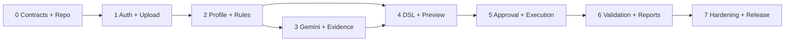

# 06 — Phased Delivery, Dependency Graph and Release Plan

> v1.0 | Proposed milestone sequencing; time estimates deliberately omitted until capacity is measured.

## 1. Operating model

Develop as **vertical slices**, not disconnected frontend/backend stubs. A slice is done only with working UI→API→DB/worker→result, tested failures and documentation. Use a short-lived feature branch, small PR, ADR when architecture changes, and one demo artifact per milestone. Deploy local/staging before claiming any feature is complete.

## 2. Dependency map



## 3. Milestones and evidence

| Stage | Main deliverables | Hard acceptance gate | Primary dependencies |
|---|---|---|---|
| M0 — Foundation | Monorepo, Docker Compose, DRF/Next, Postgres/Redis, CI, type/lint, OpenAPI skeleton, ADRs, `.env.example` | One command starts healthy apps and migration in a clean clone; CI green | None |
| M1 — Dataset admission | Auth and memberships, project and upload UI, quotas, quarantine, immutable v0, job persistence | Upload valid sample, reject malformed/oversize, deny cross-user access, replay idempotently | M0 |
| M2 — Deterministic engine | Profiles, null/duplicates/types/ranges, IQR advisories, findings IDs, Matplotlib/Seaborn image charts | Golden corpus counts match, accessible UI renders and no Gemini dependency | M1 |
| M3 — AI insight vertical slice | Evidence minimizer, Gemini adapter, prompt templates, Pydantic response verifier, cost logs | Live synthetic provider smoke + offline utility/safety eval, no canary egress | M2 |
| M4 — Controlled plan + preview | Typed DSL, policy engine, plan validator, sample preview and impact UX | No arbitrary code, invalid proposal rejected, preview warnings shown, test cases pass | M2/M3 |
| M5 — Versioned remediation | Exact-hash approval, async apply, immutable output version, retries/idempotency, audit | Original SHA unchanged, stale approvals rejected, crash recovery tests | M4 |
| M6 — Outcome evidence | Before/after validation, lineage UI, cleaned CSV, PDF/HTML, provenance and downloadable charts | Report consistent with version/result; CSV injection test; full end-to-end demo | M5 |
| M7 — Release hardening | Load tests, dependency/licensing checks, backup/restore, runbooks, accessibility, screenshots, release notes | Release checklist 100% on mandatory gates; hosted pilot separately approved | M6 |

## 4. Product backlog with acceptance scenarios

**Epic E1 — Ingestion and provenance:** create project, upload bounded CSV, reject invalid formats, show schema and status, preserve exact SHA. Stories require role and quota tests.

**Epic E2 — Trustworthy quality findings:** profile types/nulls/categories/numerics, find duplicates and missing required fields, display evidence IDs and exact affected counts, show potential anomaly labels distinct from confirmed defects.

**Epic E3 — Explainable AI:** send policy-cleared facts only; get ranked issue-linked explanations and typed operations; show provenance and limitations; support no-answer and quota failures.

**Epic E4 — Safe remediation:** plan creation, strict validation, representative sample preview, high-impact warning, exact version approval, idempotent execution into new artifact.

**Epic E5 — Validation and reporting:** rerun deterministic checks, compare metrics and quality regressions, render charts plus accessible tables, export signed immutable report and cleaned dataset.

**Epic E6 — Trust and operations:** role-guarded endpoints, deletion, telemetry, async retries, privacy checks, migration/restore, deployment documentation.

## 5. Repository plan

```text
synthesift/
├── README.md                  # product overview, demo, local setup, limitations
├── CONTRIBUTING.md            # workflow and review gates
├── LICENSE                    # choose deliberately before public release
├── .env.example               # placeholders only; never keys
├── .github/workflows/         # lint/test/contract/security/image build
├── apps/
│   ├── web/                   # Next.js / React / TypeScript / Node
│   └── api/                   # Django + DRF, application modules
├── packages/
│   └── api-client/            # generated/validated TS API contracts
├── workers/                   # optional packaging; same Django codebase/Celery
├── contracts/                 # OpenAPI, JSON schema and error DTOs
├── docs/
│   ├── 01_PRODUCT_HARNESS.md
│   ├── 02_ARCHITECTURE.md
│   ├── 03_STAKEHOLDERS.md
│   ├── 04_SECURITY_PRIVACY.md
│   ├── 05_QUALITY_AI_EVAL.md
│   ├── 06_DELIVERY_PLAN.md
│   ├── 07_DATA_API_CONTRACTS.md
│   ├── 08_OPERATIONS_RUNBOOKS.md
│   ├── diagrams/
│   └── adr/
├── tests/
│   ├── fixtures/             # synthetic, labeled and seeded
│   ├── integration/
│   ├── e2e/
│   ├── adversarial/
│   └── evaluation/
├── infra/                     # local compose, reverse proxy, infra templates
└── scripts/                   # bootstrap, migrate, seed, smoke, eval
```

A dedicated `workers/` directory is optional; avoid duplicate Celery app code. The documentation-only package currently delivered is an **architecture kit**, not the finished implementation monorepo.

## 6. Definition of ready / done per story

**Ready**: user journey, role, request/response schemas, data privacy classification, error paths, named acceptance fixture, migration and observability impact, dependencies and rollback approach. **Done**: all code/tests/docs and UX states merged; CI green; API contract current; feature demo run; security negative cases pass; traces and cost data validated; no hardcoded secrets; original source integrity preserved.

## 7. Release governance / artifacts

For every milestone produce a tagged demo build, release notes, changelog, screenshots that reflect real behavior, test evidence, known limitations and an updated architecture/ADR. For model or prompt version changes, attach an eval comparison and rollback config. For data migration, attach forward and reverse procedures. For security boundary changes, review threat model and require release gate approval.

## 8. Top risks and mitigations

| Risk | Likelihood / impact (initial qualitative) | Prevention / contingency | Owner |
|---|---|---|---|
| Outgoing payload exposes sensitive values | Medium / Critical | Fail-closed minimizer, canary tests; disable Gemini | SEC/AI |
| Unsafe transformations corrupt data | Medium / Critical | DSL allowlist, immutable versions, hashes, staged execution | BE |
| Gemini costs or API shape change | Medium / High | Provider adapter, presets, budgets, fixtures and offline mode | AI/OPS |
| CSV size or schema exhaustion | High / High | Explicit caps, worker limits, perf corpus; defer bigger data | BE/OPS |
| MVP scope creep | High / Medium | Release gates, non-goals, ADR-required scope change | PO |
| Missing customer utility | Medium / High | Realistic case studies and task-based user feedback | PO |
| Async jobs stuck/orphaned | Medium / High | Persistent job state, reconciliation, idempotent retry | BE/OPS |
| Weak portfolio credibility | Medium / Medium | Explicit status claims, runnable tests/demo, no mock-only screenshots | PO |
| Hosted regulatory/privacy obligations | Medium / High | Legal/privacy review, deletion and retention, limited pilot | SEC |

## 9. Definition of project success

First success is a **fully tested, independently runnable MVP** that processes synthetic and user-authorized CSVs end-to-end with a *real optional Gemini call*, not an architecture diagram alone. Second success is useful evaluation evidence and a repeatable secure demo. Third, conditional success is an externally reviewed pilot; monetization or enterprise certification is not assumed.

## 10. Sprint intake and Kanban standards

Each issue includes: `FR-ID`, severity, persona, acceptance criteria, implementation notes, design/security implications, test case IDs, blocked-by links, demo evidence link and definition-of-done checklist. Label `feature`, `bug`, `security`, `ai-eval`, `infra`, `docs`, and `adr`. Enforce reasonable WIP and favor finishing thin vertical slices.

## M0 implementation note (2026-10-23)

The application foundation has been authored in the monorepo. Refer to `09_M0_IMPLEMENTATION.md` for implementation mappings, testing commands, remaining verification gates and dependency-lock limitations. M0 is not yet a verified release; the original milestone acceptance criteria still apply.
